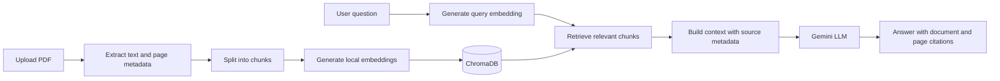

# Academic RAG

**Turn your research PDFs into a searchable, evidence-grounded study assistant.** Upload papers, ask questions in plain language, and inspect the exact page excerpts behind each answer.

## 🚀 Live Demo

**Try Academic RAG online:** [https://acadamicrag.streamlit.app/](https://acadamicrag.streamlit.app/)

Upload academic PDFs, ask questions in natural language, and explore evidence-grounded answers with document and page citations.


Academic RAG is a document question-answering application that helps students and researchers understand academic PDFs. It extracts text, divides it into searchable chunks, generates embeddings locally, and retrieves relevant evidence to ground answers generated by Google Gemini.

Answers include document names, page numbers, and supporting excerpts so users can verify responses against the original material.

## ✨ Features

| Feature | Description |
|---|---|
| PDF Upload | Upload and index multiple academic PDFs. |
| Text Extraction | Extract PDF text while preserving page metadata. |
| Text Chunking | Divide extracted text into smaller, overlapping passages. |
| Local Embeddings | Generate embeddings using Sentence Transformers. |
| Semantic Retrieval | Find relevant passages using ChromaDB vector search. |
| AI Answers | Generate evidence-grounded answers using Google Gemini. |
| Page Citations | Display source document names, page numbers, and relevant excerpts. |
| Persistent Storage | Store uploaded PDFs and the vector index locally in the configured data directory. |
| Document Management | Delete individual documents or clear the document collection. |
| Conversation Controls | Clear the current conversation without deleting indexed documents. |
| Duplicate Detection | Detect identical PDF contents using SHA-256 before indexing. |

## 🏗️ Architecture

Academic RAG consists of two connected pipelines: document ingestion and question answering.

### Architecture Diagram



### Document Ingestion Pipeline

1. **Upload PDF:** The user uploads academic documents through the Streamlit interface.
2. **Extract text:** PyMuPDF extracts text from each page and preserves page metadata.
3. **Chunking:** The extracted text is divided into smaller, overlapping passages.
4. **Embedding generation:** Sentence Transformers converts each chunk into a numerical vector locally.
5. **Vector storage:** ChromaDB stores the vectors, text chunks, and associated metadata.

### Question-Answering Pipeline

1. **User question:** The user enters a question in natural language.
2. **Query embedding:** The embedding model converts the question into a vector.
3. **Retrieval:** ChromaDB retrieves semantically relevant passages.
4. **Context construction:** Retrieved passages, source metadata, and the question are assembled into context.
5. **Answer generation:** The configured Google Gemini model generates an answer using the supplied evidence.
6. **Source citations:** The application displays the answer with document names, page numbers, and supporting excerpts.

## 🛠️ Technology Stack

| Technology | Purpose |
|---|---|
| Python | Application logic and RAG pipeline |
| Streamlit | User interface |
| PyMuPDF | PDF text extraction |
| Sentence Transformers | Local embedding generation |
| ChromaDB | Vector storage and retrieval |
| Google Gemini API | Answer generation |
| python-dotenv | Environment configuration |
| pytest | Automated testing |

## 📋 Requirements

- Python 3.11 or 3.12 recommended.
- A Google Gemini API key for answer generation.
- Internet access for dependency installation, the initial embedding-model download, and Gemini API requests.

A Gemini API key is not required for document indexing if the application supports indexing independently, but answer generation requires a valid key and access to the configured model.

## ⚙️ Installation

Clone your repository and enter the project directory:

```bash
git clone https://github.com/GopichandGuguloth555/ACADAMIC_RAG.git
cd ACADAMIC_RAG
```

### Linux and macOS

Create and activate a virtual environment:

```bash
python3 -m venv .venv
source .venv/bin/activate
```

Install dependencies:

```bash
python -m pip install --upgrade pip
python -m pip install -r requirements.txt
```

Create the local environment file:

```bash
cp .env.example .env
```

### Windows PowerShell

Create and activate a virtual environment:

```powershell
py -3.11 -m venv .venv
.\.venv\Scripts\Activate.ps1
```

Install dependencies:

```powershell
python -m pip install --upgrade pip
python -m pip install -r requirements.txt
```

Create the environment file:

```powershell
Copy-Item .env.example .env
```

If PowerShell blocks activation, use Command Prompt:

```bat
.venv\Scripts\activate.bat
```

## 🔑 Configure the Gemini API

Obtain an API key from [Google AI Studio](https://aistudio.google.com/app/apikey).

Add it to your local `.env` file:

```dotenv
GEMINI_API_KEY=your_gemini_api_key_here
```

Optional model settings, if supported by your application configuration:

```dotenv
GEMINI_MODEL=your_supported_gemini_model
EMBEDDING_MODEL=sentence-transformers/all-MiniLM-L6-v2
```

Use a currently supported Gemini model available to your API key. Model names must match those supported by your implementation.

**Security:** Never hardcode API keys in source code or commit `.env` to GitHub. For Streamlit Community Cloud, configure secrets through the app's settings instead of uploading your local `.env` file.

## ▶️ Run Locally

With the virtual environment activated:

```bash
streamlit run app.py
```

Open the local URL shown in the terminal, usually:

```text
http://localhost:8501
```

### How to Use

1. Open the application.
2. Upload academic PDFs through the sidebar.
3. Start indexing and wait for processing to finish.
4. Ask a question about the uploaded documents.
5. Review the generated answer.
6. Expand the source sections to inspect supporting excerpts and page numbers.
7. Delete documents or clear the collection when needed.

The first indexing operation can take longer because the embedding model may need to be downloaded.

## 📁 Project Structure

```text
ACADAMIC_RAG/
├── app.py
├── config.py
├── requirements.txt
├── .env.example
├── .gitignore
├── README.md
├── services/
│   ├── chunker.py
│   ├── embeddings.py
│   ├── llm_service.py
│   ├── pdf_processor.py
│   ├── rag_service.py
│   ├── retriever.py
│   └── vector_store.py
├── tests/
└── data/
    ├── uploads/
    └── chroma/
```

This is an illustrative structure. Your actual repository may contain additional files or different module names.

## 🧪 Run Tests

Activate the virtual environment and run:

```bash
pytest -q
```

Unit tests should use temporary data and mocked external model calls where appropriate. This allows ordinary tests to run without a Gemini API key.

## 🔒 Data Storage and Privacy

- Uploaded PDFs are stored locally in the configured upload directory.
- ChromaDB stores the vector index in the configured data directory.
- Embeddings are generated locally using Sentence Transformers.
- When a question is submitted, the question and retrieved excerpts are sent to Google Gemini for answer generation.
- The architecture does not require a remote vector database.
- Keep `.env`, API keys, private PDFs, and generated database files out of public Git repositories.

### Deployment Notes

The live demo is hosted on Streamlit Community Cloud.

**Live application:** [acadamicrag.streamlit.app](https://acadamicrag.streamlit.app/)

Local files and ChromaDB data on your computer are not automatically available to the hosted application. Uploaded documents and vector indexes may also be lost when hosted storage is reset or the app is redeployed. Use suitable persistent storage if long-term retention is required.

## ⚠️ Limitations

- Scanned or image-only PDFs require OCR before their text can be retrieved.
- Retrieval quality depends on document content, chunking, the embedding model, and search configuration.
- The language model may generate inaccurate answers even when source passages are supplied.
- Citations help users verify responses but do not guarantee correctness.
- Gemini answer generation depends on API availability, quota, network access, and model support.
- The public demo may be subject to hosting resource limits and availability restrictions.

## 🔮 Future Improvements

Potential enhancements include:

- Hybrid keyword and semantic search.
- Reranking retrieved passages.
- Query rewriting.
- Exam preparation and quiz generation.
- Retrieval and answer-quality evaluation.
- Improved source verification.
- Reliable persistent storage for cloud deployment.

## 📄 License

Add an appropriate open-source license if you intend to distribute this project publicly.
