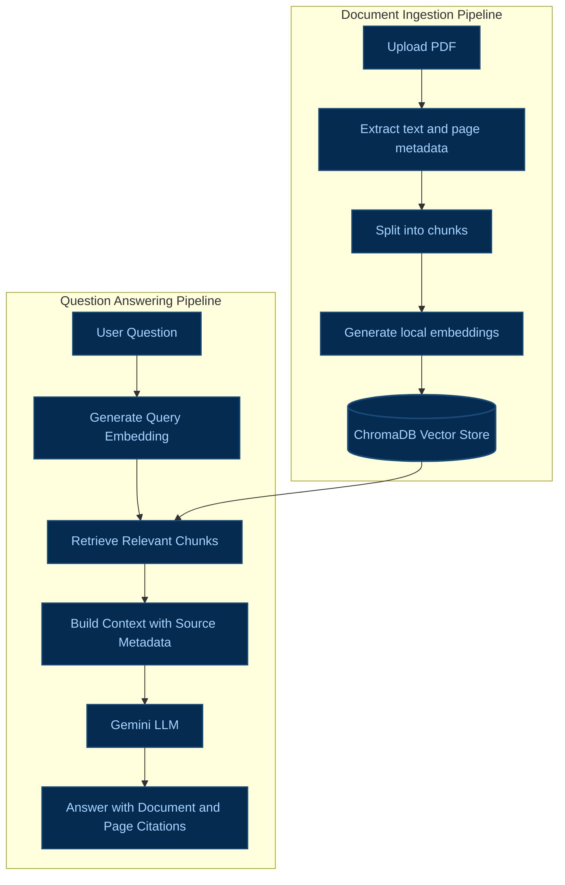

# Academic RAG

**Turn your research PDFs into a searchable, evidence-grounded study assistant.** Upload papers, ask questions in plain language, and inspect the exact page excerpts behind each answer.


Academic RAG is a local-first document question-answering application. It extracts text from academic PDFs, divides it into searchable chunks, generates embeddings locally, and retrieves relevant evidence to ground Gemini's answers.

Answers include document names, page numbers, and supporting source excerpts so users can verify the generated responses against the original material.

## Features

| Feature | Description |
|---|---|
| PDF upload | Upload and index multiple academic PDFs. |
| Text extraction | Extract PDF text while preserving page-level metadata. |
| Text chunking | Divide extracted text into smaller, overlapping passages. |
| Local embeddings | Generate embeddings using Sentence Transformers. |
| Semantic retrieval | Find relevant passages using ChromaDB vector search. |
| AI answers | Generate evidence-grounded answers using Google Gemini. |
| Page citations | Display source document names, page numbers, and relevant excerpts. |
| Persistent storage | Store uploaded PDFs and the vector index locally. |
| Document management | Delete individual documents or clear the document collection. |
| Conversation controls | Clear the current conversation without deleting indexed documents. |
| Duplicate detection | Identify identical PDF contents using SHA-256 before indexing. |

## How It Works

The application has two main pipelines: document ingestion and question answering.

### Architecture Diagram



### 1. Document Ingestion Pipeline

**Step 1: Upload PDF**

The user uploads one or more academic PDF documents through the Streamlit interface.

**Step 2: Extract text and page metadata**

PyMuPDF extracts text from each PDF page. The application preserves the original document name and page number for citations.

**Step 3: Split into chunks**

The extracted text is divided into smaller, overlapping chunks to make relevant information easier to retrieve.

**Step 4: Generate local embeddings**

Sentence Transformers converts each chunk into a numerical vector representing its semantic meaning. Embeddings are generated locally on the user's machine.

**Step 5: Store in ChromaDB**

ChromaDB stores the embeddings, chunk text, and associated metadata in a persistent local vector store.

### 2. Question-Answering Pipeline

**Step 1: Receive the user question**

The user enters an academic question in natural language.

**Step 2: Generate the query embedding**

The same embedding model converts the question into a vector so that it can be compared with the stored document vectors.

**Step 3: Retrieve relevant chunks**

ChromaDB retrieves passages that are semantically similar to the query.

**Step 4: Build context with source metadata**

The application combines the retrieved passages, document names, page numbers, and the user's question into context for the language model.

**Step 5: Generate an answer using Gemini**

The retrieved evidence and question are sent to the configured Google Gemini API. The model generates an answer grounded in the provided context.

**Step 6: Display the answer with citations**

The Streamlit interface displays the answer and its supporting document and page citations. Users can expand source sections to inspect the retrieved excerpts.

## Technology Stack

| Technology | Purpose |
|---|---|
| Python | Application logic and RAG pipeline |
| Streamlit | Web interface |
| PyMuPDF | PDF text extraction |
| Sentence Transformers | Local embedding generation |
| ChromaDB | Persistent vector storage and retrieval |
| Google Gemini API | Answer generation |
| python-dotenv | Environment variable configuration |
| pytest | Automated testing |

## Requirements

- Python 3.11 or 3.12 recommended.
- A Google Gemini API key for answer generation.
- Internet access for dependency installation, the initial embedding model download, and Gemini API requests.

The application can be installed and documents can be indexed without a Gemini API key, but generating answers requires a valid key and access to the configured model.

## Installation

Open a terminal in the project directory.

### Linux and macOS

Create and activate a virtual environment:

```bash
python3 -m venv .venv
source .venv/bin/activate
```

Install the dependencies:

```bash
python -m pip install --upgrade pip
python -m pip install -r requirements.txt
```

Create your local environment configuration:

```bash
cp .env.example .env
```

### Windows PowerShell

Create and activate a virtual environment:

```powershell
py -3.11 -m venv .venv
.\.venv\Scripts\Activate.ps1
```

Install dependencies:

```powershell
python -m pip install --upgrade pip
python -m pip install -r requirements.txt
```

Create the local environment file:

```powershell
Copy-Item .env.example .env
```

If PowerShell blocks virtual-environment activation, use Command Prompt and run:

```bat
.venv\Scripts\activate.bat
```

## Configure the Gemini API

Obtain an API key from [Google AI Studio](https://aistudio.google.com/app/apikey).

Open `.env` and configure:

```dotenv
GEMINI_API_KEY=your_gemini_api_key_here
```

Optional model settings, if supported by your application configuration:

```dotenv
GEMINI_MODEL=gemini-3.5-flash-lite
EMBEDDING_MODEL=sentence-transformers/all-MiniLM-L6-v2
```

Use a currently supported Gemini model that is available to your API key. The configured model names must match the settings read by your application.

Never hardcode API keys in source code or commit `.env` to Git.

## Run the Application

With the virtual environment activated, execute:

```bash
streamlit run app.py
```

Streamlit will print a local URL, usually:

```text
http://localhost:8501
```

Open the URL in your browser.

### Using Academic RAG

1. Upload academic PDFs using the sidebar.
2. Index the uploaded documents if the interface provides a separate indexing action.
3. Wait for text extraction, chunking, embedding generation, and storage to complete.
4. Enter a question in the chat interface.
5. Review the generated answer.
6. Expand the source sections to inspect the cited passages and page numbers.
7. Delete documents or clear the collection when needed.

The first indexing operation can take longer because the embedding model may need to be downloaded.

## Project Structure

```text
ACADAMIC_RAG/
├── app.py
├── config.py
├── requirements.txt
├── .env.example
├── .gitignore
├── README.md
├── services/
│   ├── chunker.py
│   ├── embeddings.py
│   ├── llm_service.py
│   ├── pdf_processor.py
│   ├── rag_service.py
│   ├── retriever.py
│   └── vector_store.py
├── tests/
└── data/
    ├── uploads/
    └── chroma/
```

The actual repository may contain additional modules or different filenames depending on the implementation.

## Run Tests

Activate the virtual environment and run:

```bash
pytest -q
```

Tests should use temporary data and mocked external model calls where appropriate, so ordinary unit tests do not require a Gemini API key.

## Data Storage and Privacy

- Uploaded PDFs are stored locally in `data/uploads/`.
- ChromaDB stores the vector index under `data/chroma/`.
- Embeddings are generated locally using Sentence Transformers.
- When a question is submitted, the question and retrieved source excerpts are sent to the configured Gemini API for answer generation.
- No remote vector database is required by this architecture.
- Keep `.env`, API keys, private PDFs, and generated local data out of public Git repositories.

For a cloud deployment, local files and the local ChromaDB index on your computer will not automatically be available to the hosted application. Cloud storage and secrets must be configured separately.

## Limitations

- Scanned or image-only PDFs require OCR before their text can be retrieved.
- Retrieval quality depends on the document content, chunking strategy, embedding model, and similarity search.
- The language model may still generate inaccurate answers even when source passages are provided.
- Citations help users verify responses but do not guarantee correctness.
- Gemini answer generation depends on API availability, quotas, network access, and model support.

## Future Improvements

Possible future enhancements include:

- Hybrid keyword and semantic search.
- Reranking retrieved passages.
- Query rewriting.
- Exam preparation and quiz generation.
- Improved answer evaluation and source verification.
- Persistent cloud deployment with appropriate storage.

## License

Add your chosen open-source license here if you intend to distribute the project publicly.

