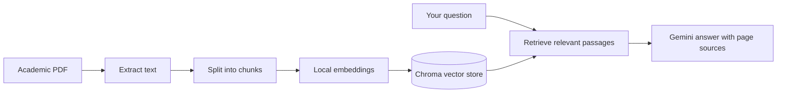

# Academic RAG

**Turn your research PDFs into a searchable, evidence-grounded study assistant.** Upload papers, ask questions in plain language, and inspect the exact page excerpts behind each answer.


Academic RAG is a local-first document question-answering app. It extracts text from academic PDFs, splits it into searchable passages, creates embeddings on your machine, and retrieves relevant evidence to ground Gemini's answers. Source excerpts include document names and page numbers, so you can check the answer against the original material.

## What It Does

| Capability | Details |
| --- | --- |
| PDF library | Upload and index multiple text-based academic PDFs |
| Semantic search | Find relevant passages using a local Sentence Transformers embedding model |
| Cited answers | Ask questions and inspect the supporting excerpt and page for each source |
| Persistent workspace | Store uploaded PDFs and the Chroma vector index under `data/` |
| Document controls | Remove a document, clear the library, or clear the current conversation |
| Duplicate protection | Detect identical PDF contents using SHA-256 before indexing again |

## How It Works



PDF text, embeddings, and the vector index stay on your machine. When you request an answer, the question and retrieved excerpts are sent to the configured Google Gemini API for generation.

## Requirements

- Python **3.11 or 3.12** recommended.
- A Google Gemini API key to generate answers. You can install the app and index documents without one, but answer generation requires it.
- Internet access for installing dependencies, downloading the embedding model on first use, and calling Gemini.

## Install

Open a terminal in the project directory and create a virtual environment.

### Linux and macOS

```bash
python3 -m venv .venv
source .venv/bin/activate
python -m pip install --upgrade pip
python -m pip install -r requirements.txt
cp .env.example .env
```

### Windows PowerShell

```powershell
py -3.11 -m venv .venv
.\.venv\Scripts\Activate.ps1
python -m pip install --upgrade pip
python -m pip install -r requirements.txt
Copy-Item .env.example .env
```

If PowerShell blocks virtual-environment activation, use Command Prompt and run `.venv\Scripts\activate.bat`, then continue with the `python -m pip` commands above.

## Configure Your API Key

Open `.env` and replace the placeholder with your key from [Google AI Studio](https://aistudio.google.com/app/apikey):

```dotenv
GEMINI_API_KEY=your_gemini_api_key_here
```

Optional model settings are also available in `.env`:

```dotenv
GEMINI_MODEL=gemini-3.5-flash-lite
EMBEDDING_MODEL=sentence-transformers/all-MiniLM-L6-v2
```

The app reads these settings at startup. Keep `.env` private; it is excluded from version control.

## Start the App

With the virtual environment active, run:

```bash
streamlit run app.py
```

Streamlit prints a local URL in the terminal and opens the app in your browser. Upload PDFs from the sidebar and select **Index uploaded PDFs**. Then ask a question in the chat and expand the source sections to review the evidence and page numbers.

The first indexing run downloads the embedding model and may take a little longer. Scanned or image-only PDFs are not text-searchable until OCR has been applied. Re-uploaded files with identical contents are recognized and won't be indexed twice.

## Project Layout

```text
ACADAMIC_RAG/
├── app.py                  # Streamlit interface and document workflow
├── config.py               # Models, chunk settings, and local data paths
├── services/
│   ├── chunker.py           # Split extracted pages into text chunks
│   ├── embeddings.py        # Local Sentence Transformers embeddings
│   ├── llm_service.py       # Gemini answer generation
│   ├── pdf_processor.py    # PDF validation and text extraction
│   ├── rag_service.py       # Retrieval-augmented answer orchestration
│   ├── retriever.py         # Relevant passage search
│   └── vector_store.py      # Persistent Chroma storage
├── tests/                   # Unit tests for core services
├── data/
│   ├── uploads/             # Locally stored source PDFs
│   └── chroma/              # Persistent vector database
├── requirements.txt
└── .env.example             # Environment variable template
```

## Run the Tests

Activate the virtual environment, then run:

```bash
pytest -q
```

The tests use temporary data and mocked model services; they do not require a Gemini API key or make API calls.

## Data and Limitations

- Uploaded PDFs and the Chroma index are stored locally in `data/uploads/` and `data/chroma/`. Deleting a document removes its local PDF and indexed chunks.
- Questions and retrieved source excerpts are sent to Gemini only when you ask for an answer. No remote vector database is used.
- PDF extraction uses PyMuPDF and does not perform OCR. Prepare scanned PDFs with OCR before indexing.
- Retrieval returns a limited set of the most relevant passages. Specific questions and terms used in the source material tend to produce better results.
- Gemini answer generation needs a valid API key, network access, available quota, and access to the configured model.
